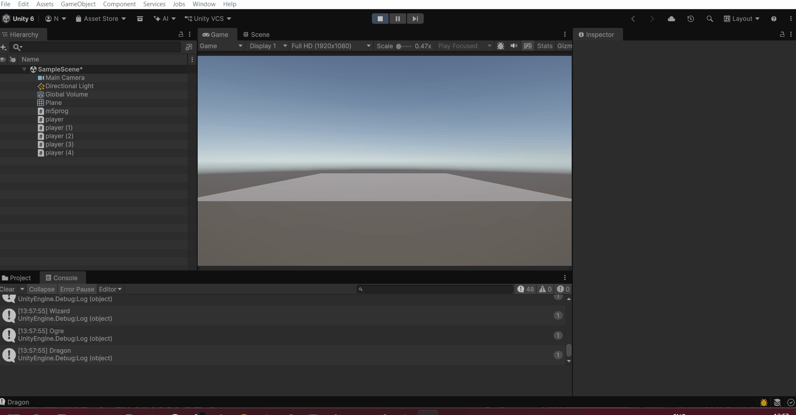
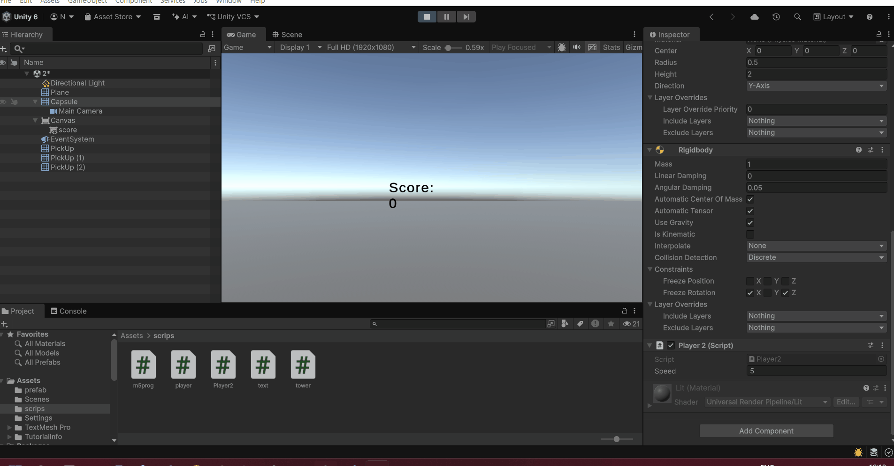
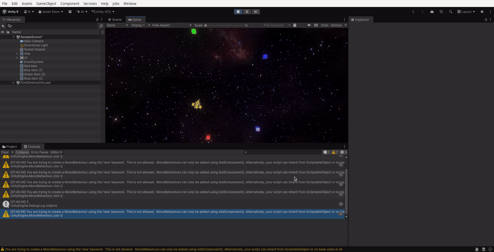

# prog-m5
# opdrach 1
# 
# [code](Assets/scrips/m5prog.cs) [code](Assets/scrips/tower.cs)
# 
# opdracht 2
# 
# [code](Assets/scrips/Player2.cs)
# opdracht 4
# 
# [repo](https://github.com/NamesSR/Space48)
